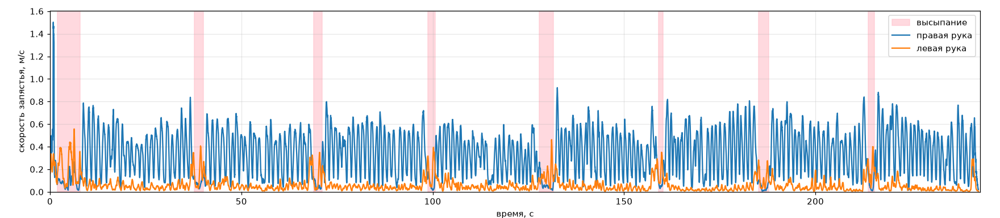

# Скорость рук по данным VR-трекинга

Визуализация записи с VR-устройства: график скорости запястий обеих рук и видео на одной странице.
Красная полоса на графике движется вместе с видео, а клик по графику перематывает видео на это место.
Розовым на графике отмечены паузы правой руки — моменты, когда предметы высыпают из корзины.



## Структура

```
data/              исходные видео и трекинг (не в репозитории, см. ниже)
analyze.py         читает трекинг, считает скорость и паузы, рисует timeline.png и пишет config.js
index.html         страница: видео + график с бегущей полосой
timeline.png       готовый график
config.js          настройки для страницы (создаёт analyze.py)
.env               пути к видео и трекингу, длина видео
requirements.txt   зависимости Python
```

## Данные

Сейчас всё рассчитано по этой записи:
- видео: [CameraRecord_20260505_165740.mp4](https://drive.google.com/file/d/1rORH02GsijiDMVcBTAjtmTYAqIAymiHE/view?usp=sharing)
- трекинг: [trackingData_20260505_165740.txt](https://drive.google.com/file/d/1SgDJT9S5fYonhk_enD40NVXKa2yW9Lva/view?usp=sharing)

Файлы весят больше 100 МБ, GitHub такие не принимает, поэтому папка `data/` в `.gitignore`.
Скачайте оба файла, переименуйте и положите в `data/`:
- `CameraRecord_20260505_165740.mp4` → `data/CameraRecord.mp4`
- `trackingData_20260505_165740.txt` → `data/trackingData.txt`

## Запуск

Посмотреть результат: откройте `index.html` в Firefox, Chrome или Edge. Пересчитывать ничего не нужно,
`timeline.png` и `config.js` уже лежат в репозитории, нужно только видео в `data/`.

Пересчитать график (Python 3):
```
pip install -r requirements.txt
python analyze.py
```

Видео закодировано в H.264. Chromium и встроенный просмотрщик VS Code этот кодек не поддерживают —
в них страница покажет предупреждение вместо видео.

## Настройки (.env)

| Переменная | Значение |
|---|---|
| `VIDEO_FILE` | путь к видео относительно `index.html` |
| `TRACKING_FILE` | путь к файлу трекинга |
| `VIDEO_LENGTH` | длина видео в секундах |

Для другой записи поменяйте эти значения и запустите `python analyze.py` заново — он перезапишет
`timeline.png` и `config.js`.
